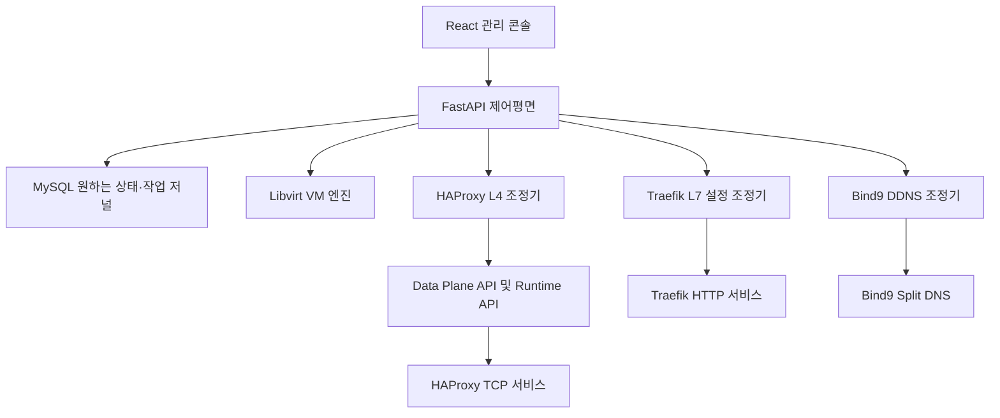
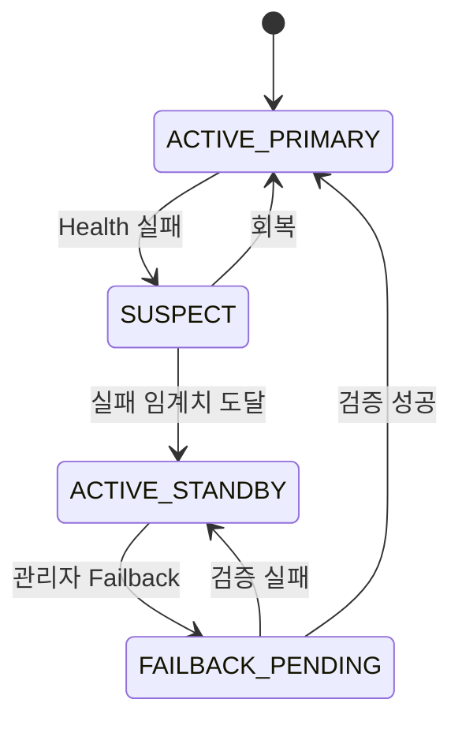

# Personal KVM DNS 및 L4 L7 로드밸런싱 통합 기능 아키텍처

버전: 설계 v0.2.0 · 작성일: 2026-11-07 · 상태: 구현 전 기능 아키텍처

## 1. 설계 목적과 원본 요구사항

Personal KVM은 Rocky Linux 9.x 및 10.x 호스트에서 FastAPI·React·MySQL·KVM/libvirt를 이용해 VM과 네트워크 서비스를 일관되게 관리하는 개인형 온프레미스 클라우드다. 본 문서는 `personal-kvm-v0.1.1.zip/docs/requirements/확장개발요청서.md`, `개발 구현요청서.md`, Gemini의 `v0.1.x_아키텍처_감사보고서.docx`, 기존 v0.1.x 아키텍처·DNS·Traefik 설명서를 대조하여 **Bind9 기반 클라우드 DNS**와 **Traefik L7 및 HAProxy L4**의 필수 기능을 통합 재정의한다. 원본의 명시적 요구와 새로운 기술 대안을 구분한다. 기존 기능 보존은 절대 수용 조건이다.

## 2. 핵심 아키텍처와 책임 경계

관리자는 React에서 DNS·가상머신·로드밸런서를 생성·수정·삭제한다. FastAPI가 인증·권한·검증·승인을 맡고 MySQL에 **원하는 상태(desired state)**와 리소스 소유권을 기록한다. 조정기는 외부 프로세스 설정을 반영하고 실제 상태(observed state)와 대조한다. VM/libvirt, Bind9, Traefik, HAProxy는 모두 독립 데이터평면이며 API 요청 성공만으로 완료 처리하지 않는다.

## 3. 네트워크 영역과 DNS 조회 정책

| 클라이언트 출처 | EXTERNAL_DOMAIN의 VM 레코드 | PRIVATE_DOMAIN의 VM 레코드 | 일반 인터넷 도메인 |
|---|---|---|---|
| Public-Bridged 및 공인 IP | 공개용 Public-Bridged IP 또는 승인된 외부 DNS 위임·포워딩 | 노출 금지(NXDOMAIN 또는 REFUSED 정책 명시) | 허용된 재귀/포워딩 정책 |
| Public-NAT | 신뢰 구역으로 인정하는지 설치 정책에 명시. 기본 외부 취급 | 기본 노출 금지 | 정책별 |
| Internal-Service | 내부 서비스 IP 우선 | Internal-Service IP | 허용된 재귀 질의 |
| Management-Net | 관리 정책에 따른 IP | 관리 허용 VM의 내부 서비스 IP | 관리 정책별 |

원본 설정 키 `EXTERNAL_DOMIAN`은 오탈자 호환 별칭으로만 유지하고 정식 키 `EXTERNAL_DOMAIN`으로 정규화한다. `PRIVATE_DOMAIN`과 `NFS_DIR`, DNS 리스너·뷰별 접근 ACL, 정방향/역방향 zone, 포워더, TSIG 키 파일을 설치 구성에 포함한다. Bind9 Views는 클라이언트 IP별로 결정하고 외부에 내부 레코드·존 전송·재귀 서비스가 유출되지 않도록 최소 권한 ACL을 적용한다. DNS 검색 도메인과 nameserver는 Cloud-init network-config로 게스트에 설정하되 **기존 `/etc/hosts`를 덮어쓰지 않는다.**

## 4. VM 생성 삭제와 DNS의 일관성

1. VM 생성 요청 검증: VM 이름 또는 사용자가 입력한 HOSTNAME, 네트워크 유형, IP 풀의 RANDOM 기본/SERIAL 선택, 게스트 계정과 암호·SSH 키, DNS 이름 중복 검사.
2. MySQL 트랜잭션: 작업 UUID와 리소스 예약, IP 임시 할당, 원하는 DNS 레코드와 상태 `PENDING` 기록.
3. libvirt 및 cloud-init: 디스크·NIC·seed 생성 후 VM 기동. Guest의 `/etc/hosts`는 보존, 내부 DNS IP와 검색 도메인을 배포.
4. Bind9 업데이트: TSIG로 `HOSTNAME.PRIVATE_DOMAIN` A/AAAA 및 필요한 PTR 등록. 공개 서비스가 선택된 경우에만 `HOSTNAME.EXTERNAL_DOMAIN`을 공개 정책에 따라 등록.
5. 검증: 내부·관리·공개 구역에서 DNS 조회 결과와 게스트 연결을 검증한 뒤 `SUCCEEDED` 처리.
6. 실패: DNS 정·역방향은 별도 zone이므로 전역 원자성을 보장한다고 가정하지 않는다. 작업 저널을 바탕으로 재시도 또는 보상 업데이트를 수행하고 기존 소유 레코드는 보호한다.
7. 삭제: 서비스 라우팅부터 비활성화하고 연결 상태 확인, 도메인·디스크·IP 순서로 회수한다. IP 재할당 전에 해당 VM의 DNS 레코드 제거와 TTL 영향을 확인한다.

**필수 화면:** DNS Zone 목록, VM별 A/PTR 및 노출 범위, 정·역방향 조회 결과, 동적 업데이트 결과, 조정 실패 재시도, TSIG 키 교체 상태, 보안 이벤트. VM 생성 위저드의 HOSTNAME 기본값은 인스턴스명이다.

## 5. L7 데이터평면 Traefik

L7은 HTTP/HTTPS의 Host 및 Path 라우팅, 복수 백엔드, TLS 종료·인증서·갱신, HTTP→HTTPS, 상태 확인, 보안 미들웨어, 무중단 File Provider 동적 갱신을 담당한다. 원본 요구대로 **요청 헤더·URI 경로·쿼리 파라미터의 비의도적 변경을 금지**하고 테스트한다.

관리 콘솔 필드: ALB명, 서비스 도메인, HTTP/HTTPS 리스너·포트, TLS 사용 및 CA·서버 인증서 관리, 백엔드 Private FQDN 또는 IP·포트·가중치, 알고리즘, 헬스체크, 보안정책, 상태.

지원 알고리즘(대상 Traefik 버전 고정 후 검증): `wrr` 가중 라운드로빈, `p2c` 두 후보 중 연결 수가 적은 쪽 선택, `hrw` 클라이언트 IP 기반 일관성 해시, `leasttime` 응답 시간과 연결 수 고려. **P2C는 모든 백엔드를 탐색하는 전통적 Least Connections가 아니다.** HTTP Sticky Cookie는 별도 기능이다.

제어평면은 DB에서 Traefik 동적 YAML을 생성하여 임시 파일에 쓰고 구문 검사 후 원자 교체한다. Traefik이 로드한 실제 라우터/서비스 및 백엔드 가용성을 확인한다. 설정 실패 시 이전 정상 파일로 복구하고 작업 오류를 표시한다. 인증서 개인키는 로그·DB 평문에 저장하지 않는다.

## 6. L4 데이터평면 HAProxy 및 API

L4 TCP는 **HAProxy Community**를 선택한다. 백엔드 알고리즘은 `roundrobin`, `leastconn`, `source`(소스 IP 해시) 세 가지를 필수 지원한다. 백엔드는 IP 또는 Private FQDN·포트, TCP 헬스체크, 최대 연결 수, 타임아웃, 서버 가중치를 명세한다. 단순 TCP에서는 TLS SNI 도메인 분기가 불가능하므로 기본은 개별 IP:Port 리스너다. TLS 기반 도메인 라우팅은 클라이언트가 SNI를 실제 전달하는 서비스에만 허용한다.

HAProxy 본체의 **Runtime API**는 UNIX socket 기반으로 서버 활성화·비활성화, 가중치 변경, 통계를 처리하며 변경이 재시작 후 자동 영속되지 않는다. 별도 오픈소스 **HAProxy Data Plane API**는 REST 기반 구성 조회·수정·검증과 적용을 담당한다. FastAPI만이 제어 API를 호출하도록 하고 이 API와 Runtime socket을 공개망에 직접 노출하지 않는다. 지속 상태의 단일 원본은 MySQL이며 Data Plane API 설정과 Runtime 변경을 주기적으로 대조한다. Data Plane API 버전과 HAProxy 패키지 호환성 및 재로드 동작은 설치 단계에서 검증한다.

## 7. L4 Active Standby 자동 Failover와 수동 Failback

원본 요구사항의 **Active 서버, Standby 서버, Active 장애 시 자동 전환, Standby 가동 중 관리자 Failback 버튼**을 독립 제어 로직으로 구현한다. 이를 단순 HAProxy 알고리즘 설정 하나로 완료했다고 간주하지 않는다.

상태는 `ACTIVE_PRIMARY`, `SUSPECT`, `ACTIVE_STANDBY`, `FAILBACK_PENDING`, `FAILED`, `MAINTENANCE`를 사용한다. 기본 Primary가 정해진 연속 헬스체크 실패 횟수에 도달하면 원인을 기록하고 Standby를 활성화한다. 자동으로 Primary를 복귀시키지 않고 관리자가 복구 확인 후 **Failback**을 요청하도록 기본 정책을 정한다. Failback 버튼은 `ACTIVE_STANDBY`이고 Primary가 건강할 때만 활성화한다.

Failback 요청 시 ① 관리자 권한·현 상태·Primary 건강 확인, ② Standby 신규 연결 차단과 진행 중 연결의 drain 정책 적용, ③ Primary 활성화, ④ 실제 트래픽 및 연결 확인, ⑤ 상태 DB 저장 순으로 처리한다. 단계 실패 시 이전 Standby 서비스로 복귀하고 오류를 남긴다. 기존 TCP 세션은 백엔드 변경만으로 무중단 이동되지 않으므로 drain 기한 후 종료 여부를 관리자가 정책으로 선택해야 한다. 이중화 대상은 **백엔드**이며 HAProxy 단일 프로세스 자체의 HA는 별도 범위다.

## 8. 통합 관리자 화면과 API 요구

메뉴: **대시보드 / 인스턴스 / 디스크 / 네트워크·IP 풀 / OS 이미지 / DNS 관리 / 공유볼륨 / L7 로드밸런서 / L4 로드밸런서 / 작업·감사 로그 / 시스템 설정**.

REST 엔드포인트(제안): `GET/POST /api/v1/dns/zones`, `GET /api/v1/dns/records`, `POST /api/v1/dns/reconcile`, `GET/POST /api/v1/load-balancers`, `GET /api/v1/load-balancers/{id}`, `POST /api/v1/load-balancers/{id}/failback`, `GET /api/v1/load-balancers/{id}/health`, `GET /api/v1/operations/{uuid}`. 모든 변경은 멱등 요청 ID, 관리자 인증, 입력 검증, 비밀 마스킹, 감사 로그, 작업 상태를 갖는다.

LB 목록: 순번, 이름, L4/L7, 서비스 도메인·리스너, 알고리즘, Primary/Standby, 백엔드 실시간 상태, 현재 Active, 장애 사유, 최종 변경 시각, Failback 활성 여부. DNS 화면에는 Public/Internal/Management별 조회 검증 버튼과 오류 상세를 제공한다.

## 9. 설치 및 서비스 수명주기

Rocky 9/10 환경별 패키지·서비스명·SELinux·방화벽 정책을 기능 탐지하여 설치하고 `named`, `traefik`, `haproxy`, `dataplaneapi`의 systemd 동작과 재부팅 후 자동 기동을 검증한다. DNS·L4/L7 리스너 포트 중복을 사전 차단한다. 네트워크 브리지 변경은 NetworkManager 체크포인트와 원격 접속 복구 절차를 사용한다.

공유볼륨은 `NFS_DIR` 아래 생성·조회·삭제, 다중 마운트, 관리 네트워크 사용 조건을 유지한다. 제거 기능은 소유권·실행중 VM을 검사하고 백업·작업 계획·명시적 확인 없이 데이터·공유볼륨·인증서를 삭제하지 않는다. 서비스 장애나 강제 종료 후에도 작업 저널로 원하는 상태를 복구한다.

## 10. 데이터 모델 최소 집합

- `dns_zone(id, name, view, type, enabled)` 및 `dns_record(id, zone_id, vm_id, name, type, value, ttl, desired_state, observed_state)`.
- `lb_service(id, name, layer, listener_ip, listener_port, domain, tls_mode, algorithm, ha_mode, state)`.
- `lb_backend(id, lb_id, vm_id, address, port, role, weight, health_state, last_check)`.
- `lb_transition(id, lb_id, from_state, to_state, reason, actor, started_at, completed_at, outcome)`.
- `operation_journal(uuid, resource_type, resource_id, action, phase, desired_state, observed_state, error, retry_count, timestamps)`.
- `secret_reference`는 비밀 저장 위치만 기록하고 키·인증서 개인키 원문은 별도 접근통제된 파일/비밀 저장소에서 관리한다.

실제 DB 스키마 변경은 기존 v0.1.1 MySQL 스키마·마이그레이션을 조사한 뒤 추가·변경한다. 운영 중 자료를 잃는 드롭/재생성 방식은 사용하지 않는다.

## 11. 필수 검증과 완료 판정

1. DNS: Public에서 Private 조회 차단, 내부/관리에서 허용, VM 생성·삭제 A/PTR 정합성, 키 권한 및 재시도.
2. L7: WRR/P2C/HRW/Least-Time 선택 및 관측, TLS, 복수 백엔드 장애 제거, Header·Path·Query 무변형.
3. L4: 실제 TCP로 RR/LeastConn/Source Hash 동작, Data Plane API 생성·수정·삭제, Runtime 변경 지속성 조정.
4. L4 HA: 강제 Primary 장애→Standby 전환→Primary 건강 회복→Failback 버튼→실제 트래픽 복귀, 진행 연결 정책과 오류 복구.
5. VM: Cloud-init 계정·암호/SSH, `/etc/hosts` 보존, 네트워크별 NIC 접속, IP RANDOM/SERIAL, 0·다중 추가 디스크.
6. 운영: Rocky 9/10 클린 설치, 재부팅, API 접근제어, 비밀정보 노출 차단, DB/외부 프로세스 장애 및 롤백, 기존 기능 회귀.

## 12. 구현 순서와 보류 판단

P0: 원본 요구사항 추적·테스트 기반 확보, Bind9 설치·Split Views·VM DDNS 연동, L4 HA 상태 저널 및 UI 상태, 작업 롤백.

P1: HAProxy Data Plane API를 통한 L4 CRUD 및 세 알고리즘, 자동 Failover·수동 Failback, Traefik L7 알고리즘·TLS·검증, Rocky 9/10 통합.

P2: 모니터링·알림·다중 호스트 HA·고급 운영 정책. 모두 구현·검증하기 전에는 최종 완료로 선언하지 않는다.

## 13. 사실 확인과 참고 문서

- 원본: [v0.1.1 소스 ZIP](https://drive.google.com/file/d/1G26J1P4blr3fdFjcynTDY6fFMJKv9Zg9/view), 내부 `docs/requirements/확장개발요청서.md`, `개발 구현요청서.md`.
- [Gemini 감사보고서](https://drive.google.com/file/d/1z9qspO4a596xUPHWaIrlxVehSrgZIjaH/view).
- [Traefik HTTP 서비스 알고리즘](https://doc.traefik.io/traefik/reference/routing-configuration/http/load-balancing/service/): WRR, P2C, HRW, Least-Time.
- [Traefik TCP 서비스](https://doc.traefik.io/traefik/master/reference/routing-configuration/tcp/service/): TCP 로드밸런싱·서비스 가중치 및 기능 제한.
- [HAProxy 알고리즘](https://docs.haproxy.org/3.3/configuration.html): Roundrobin, Leastconn, Source Hash.
- [HAProxy Data Plane API](https://www.haproxy.com/documentation/haproxy-data-plane-api/): 별도 REST 관리 프로세스.
- [HAProxy Runtime API](https://www.haproxy.com/documentation/haproxy-runtime-api/): 비영속 메모리 기반 제어.

**설계와 구현을 구분한다.** 이 문서는 승인 가능한 기능·운영 아키텍처 초안이며, HAProxy 추가 설치, DNS 도메인 구역별 질의, L4 HA와 Failback 등은 아직 실제 코드 구현 및 시험 결과가 아니다.
